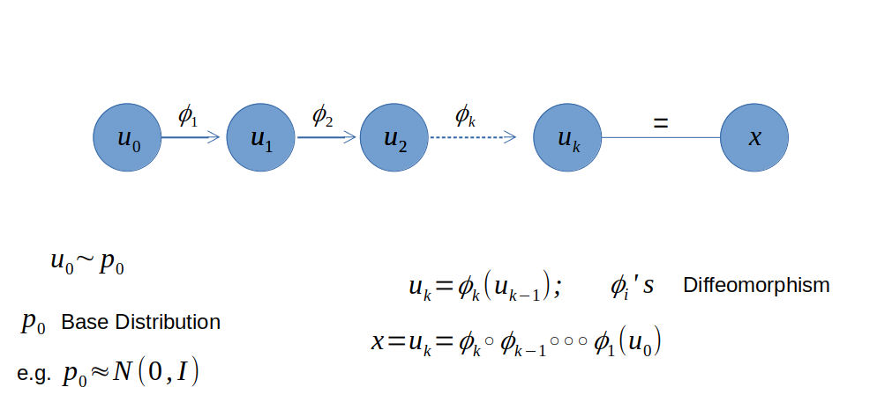
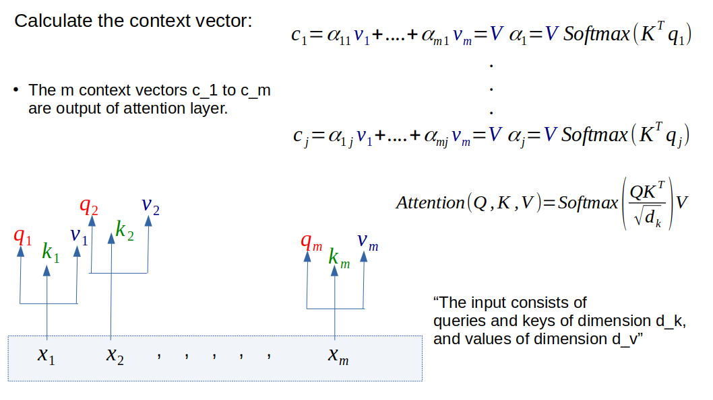
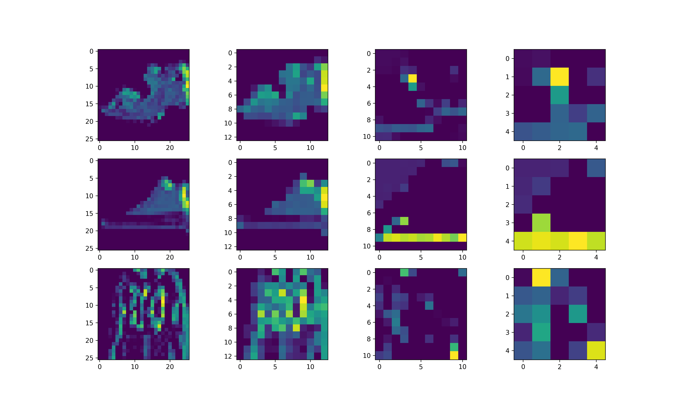
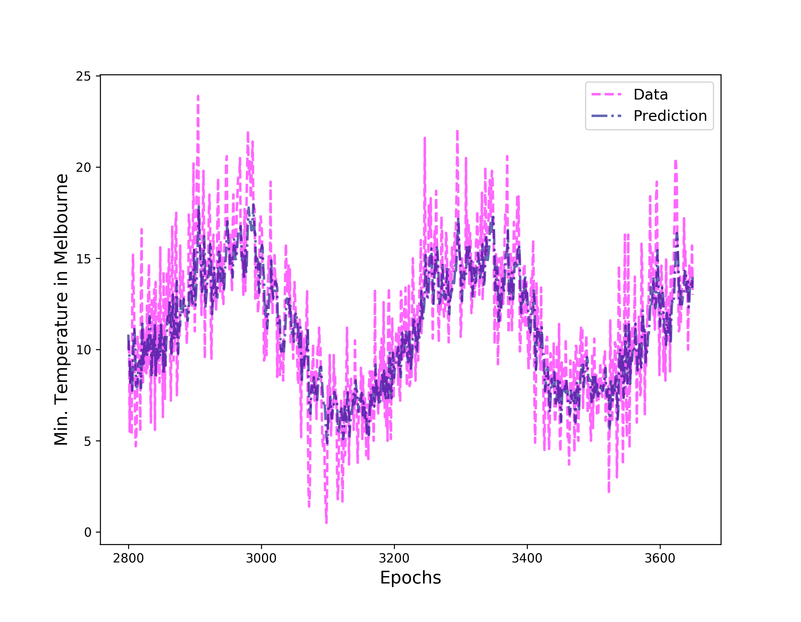

# Tutorials for TensorFlow

Hands-on notebooks for learning deep learning with TensorFlow, from the building blocks of neural networks to Vision Transformers, Bayesian deep learning and generative models. Many of them come with a detailed blog post.

A similar repository dedicated to _Machine Learning and Data Analysis_ is [here](https://github.com/suvoooo/Machine_Learning).

#### Libraries
     

<table>
  <tr>
    <td align="center" width="50%">
      
       <b>Normalizing Flows:</b> transforming distributions with TensorFlow Probability
    </td>
    <td align="center" width="50%">
      
       <b>Vision Transformer:</b> how self-attention works
    </td>
  </tr>
</table>

---

## 🆕 Recent

| Topic | Description | Code | Blog | Run |
|---|---|---|---|---|
| **ESRGAN** | From GAN to SRGAN to ESRGAN: perceptual loss, the Residual-in-Residual Dense Block and the relativistic discriminator for image super-resolution ([paper](https://arxiv.org/abs/1809.00219)). | [ESRGAN_Concepts.ipynb](ESRGAN_Concepts.ipynb) | [Medium](https://medium.com/data-science-collective/from-gan-to-srgan-to-esrgan-towards-super-resolution-2f53c246c3d4) |  |
| **Diffusion Math** | Every step of the diffusion loss explained: the forward and reverse processes of denoising diffusion probabilistic models ([DDPM paper](https://arxiv.org/abs/2006.11239)). | [Diffusion](Diffusion/) | [Medium](https://medium.com/data-science/diffusion-loss-every-step-explained-8c19c5e1349b) |  |

## Computer Vision

| Topic | Description | Code | Blog | Run |
|---|---|---|---|---|
| **Conv Basics** | Start with the building blocks of deep neural networks and slowly build and understand convolutional neural networks. Example below. | [Conv_Basic_with_TensorFlow](Conv_Basic_with_TensorFlow/) | – |  |
| **Image Generator** | Preprocess images using Keras `flow_from_directory`, with augmentation on the fly. | [im_generator](im_generator/) | – |  |
| **Multi-Class Classification** | Moving from binary classification to multi-class classification. | [Multi_Class](Multi_Class/) | – |  |
| **Transfer Learning** | Using VGG16 weights to train a model: 2800 images of cats and dogs for training and 600 for validation. | [Transfer_Learning](Transfer_Learning/) | – |  |
| **Vision Transformer** | Implement the Vision Transformer from scratch in TensorFlow 2.0, with a detailed look at how the attention mechanism actually works. | [ViT_TensorFlow](ViT_TensorFlow/) | [TDS](https://towardsdatascience.com/understand-and-implement-vision-transformer-with-tensorflow-2-0-f5435769093) |  |

How Conv and Max Pool layers understand features (training images from the Fashion-MNIST data set):

## Kaggle & Applied Projects

| Topic | Description | Code | Blog | Run |
|---|---|---|---|---|
| **Cassava Leaf Disease** | The [Kaggle competition](https://www.kaggle.com/c/cassava-leaf-disease-classification/overview) on cassava leaf disease classification. This is the same notebook used for the competition submission. | [cassava-classification.ipynb](cassava-classification.ipynb) | – |  |
| **Pneumonia Detection** | Pneumonia detection from [chest X-rays](https://www.kaggle.com/paultimothymooney/chest-xray-pneumonia) using the TensorFlow Dataset API. Concepts such as image standardization, class imbalance and the ROC curve as a performance metric were influenced by the DeepLearning.AI [AI for Medicine](https://www.deeplearning.ai/program/ai-for-medicine-specialization/) course. | [detectpneumonia-inceptionresnetv2-class-imbalance.ipynb](detectpneumonia-inceptionresnetv2-class-imbalance.ipynb) | – |  |

## Bayesian Deep Learning

| Topic | Description | Code | Blog | Run |
|---|---|---|---|---|
| **Bayesian Uncertainty** | The two types of uncertainty, aleatoric and epistemic, and how a Bayesian neural network can estimate them. Uses real weather data and TensorFlow Probability. | [Bayesian_uncertainty.ipynb](TF-Proba/Bayesian_uncertainty.ipynb) | [TDS](https://towardsdatascience.com/bayesian-deep-learning-estimating-uncertainty-9907f5208cc0) |  |

## NLP

| Topic | Description | Code | Blog | Run |
|---|---|---|---|---|
| **Word Embeddings** | Classifying IMDB movie reviews and visualizing how embeddings cluster positive and negative words. | [NLP_Embedding1](NLP_Embedding1/) | – |  |
| **LSTM + GloVe** | Using pretrained GloVe embeddings to separate positive tweets from negative ones ([Sentiment140, 1.6M tweets](https://www.kaggle.com/kazanova/sentiment140)). | [NLP_LSTM_Glove](NLP_LSTM_Glove/) | – |  |

## Time Series

| Topic | Description | Code |
|---|---|---|
| **Week 1** | Introduction to time series data. | [Time_SeriesW1](Time_SeriesW1/) |
| **Week 2** | From simple linear regression to single-layer and deep neural networks. | [Time_SeriesW2](Time_SeriesW2/) |
| **Week 3** | RNNs and LSTMs for time series. | [Time_SeriesW3](Time_SeriesW3/) |
| **Week 4** | Combining LSTM and 1D convolution; predicting sunspots and the minimum temperature of Melbourne. | [Time_SeriesW4](Time_SeriesW4/) |

Predicting the minimum temperature of Melbourne:

## Data Pipelines

| Topic | Description | Code | Blog | Run |
|---|---|---|---|---|
| **TF Data API** | An introduction to the [TF Dataset API](https://www.tensorflow.org/api_docs/python/tf/data/Dataset) and how to use it to build efficient, fast data pipelines. | [TF_Data_Intro.ipynb](TF_Data_Intro.ipynb) | [TDS](https://towardsdatascience.com/time-to-choose-tensorflow-data-over-imagedatagenerator-215e594f2435) |  |

> **Note:** some notebooks read Kaggle data sets or local files. When running them in Colab, download or upload the matching data first.
